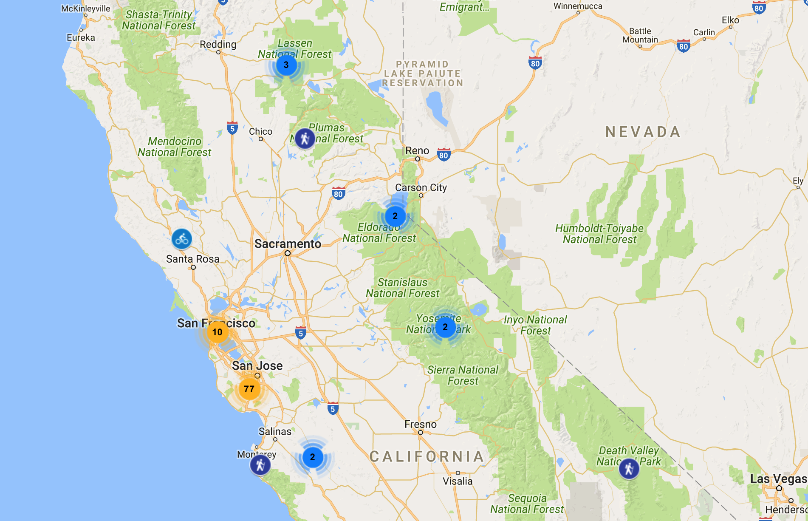
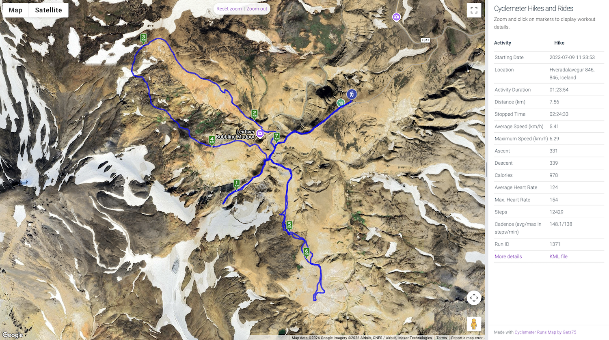
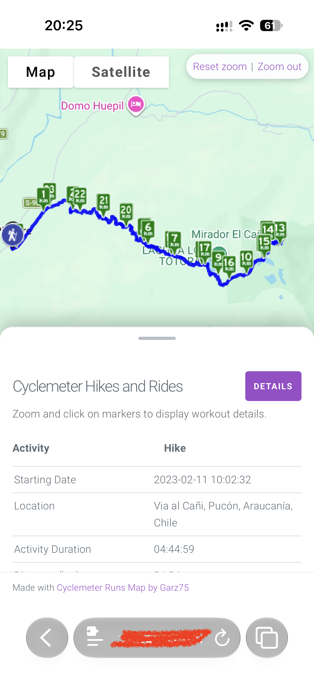

# Cyclemeter Runs Map

This is a simple map apps, using Google Maps JS API to display on a single Google map all your runs from your CycleMeter database.

## Quick start

1. Copy the project files to your web server.
1. Copy `config.example.pl` to `config.pl`.
1. Set `google_maps_api_key`, `google_maps_map_id`, and `cyclemeter_db_path` in `config.pl`.
1. Place `Meter.db` in a non-web-accessible directory.
1. Enable CGI execution for `.cgi` files (for Apache: `AddHandler cgi-script .cgi`).
1. Open `index.html` in your deployed site.

## How it works

[CycleMeter](http://abvio.com/cyclemeter/) is an iOS application to record rides, hikes, and other physical activities on your phone. It records your position, speed, altitude, heart rate, and more in a SQLite database, optionally synchronized across devices with iCloud.

Cyclemeter allows you to share workout data from its website. Once a workout is completed, Cyclemeter uploads the data to cyclemeter.com and shows it in a web page and a KML file. However, it does not provide a way to map all your activities on a single map.

This web application extracts the data from the sqlite3 database and builds a map to display every run stored in the database. It displays them as "clustered" markers on Google Maps. A click on a specific marker retrieves the run's KML through a same-origin proxy, converts its geometry to GeoJSON, and displays it with the Google Maps Data layer. See screenshots below.

The CycleMeter DB file (`Meter.db`) must be uploaded from the iPhone to the website where this application runs. It is available in the iOS Files app under Cyclemeter app storage.

You must also enable sharing in Cyclemeter. This application uses the activity KML files hosted by Cyclemeter to display workout tracks on the map.

## Requirements / Dependencies

 1. A web server to host static pages, the CGI script (Perl), and the CycleMeter SQLite database.
 1. You will need a [Google Maps JavaScript API key](https://developers.google.com/maps/documentation/javascript/get-api-key#key-restrictions). Create it in a Google Cloud project with billing enabled, then enable both the **Maps JavaScript API** and **Geocoding API**. Restrict the key to the Maps JavaScript and Geocoding APIs and to your site's HTTP referrers.
 1. Advanced markers require a [Google Maps Map ID](https://developers.google.com/maps/documentation/get-map-id). Use your own JavaScript Map ID for production instead of `DEMO_MAP_ID`.
 1. Perl dependencies on the server: CGI, JSON::XS, DateTime, DBI, DBD::SQLite. `HTTP::Tiny` is used to proxy KML requests and is included in modern Perl distributions.

### CycleMeter database compatibility

This application was tested with CycleMeter app version `12.1.62` (build `20489`). The app version is stored in the `meter.appVersion` column, and the build number is stored in `meter.appBuildNumber`.

The starting-coordinate format is reverse engineered. It may change at any time and is not guaranteed to work with every database or future CycleMeter release.

## How to use
 1. Drop the files in a web accessible directory.
 1. Upload the CycleMeter Meter.db file to a non-web-accessible directory on the server.
 1. Copy `config.example.pl` to `config.pl`.
 1. Set `google_maps_api_key`, `google_maps_map_id`, and the absolute `cyclemeter_db_path` in `config.pl`.
 1. Keep `config.pl` private: it is ignored by Git and access to it is denied by the included `.htaccess`. On a non-Apache server, configure an equivalent deny rule. Do not place `Meter.db` in a web-accessible path.
 1. Configure your web server to execute `.cgi` files as CGI. For example, with Apache:
     `AddHandler cgi-script .cgi`

Browser calls are routed through `controller.cgi` actions:

- `controller.cgi?action=config` exposes only the Maps API key and Map ID to the browser.
- `controller.cgi?action=runs` returns activities with their starting coordinates and metadata.
- `controller.cgi?action=kml&url=...` proxies only allowed KML URLs.

Browser-visible Maps credentials must be protected with HTTP-referrer and API restrictions. The database path and any other server-only settings remain private.

*Caveat*: This web app displays personal information about your movements and locations. Protect the website with authentication if you want privacy.

 ## Screenshots

 

 

 
